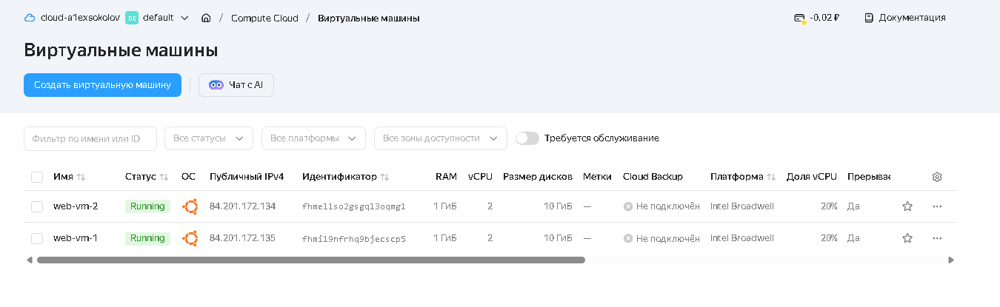
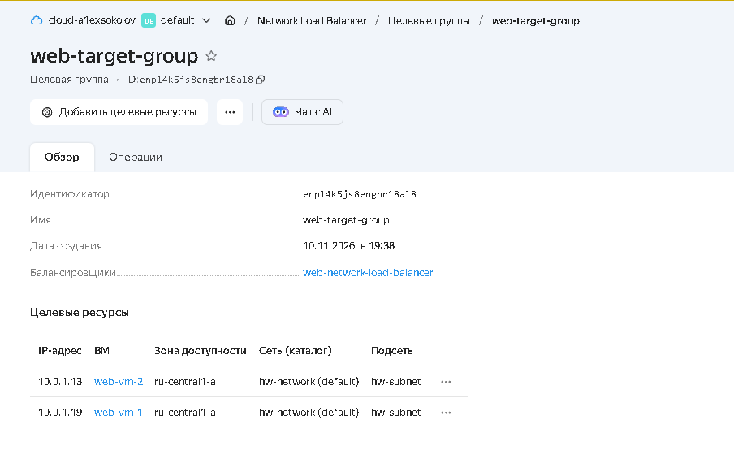
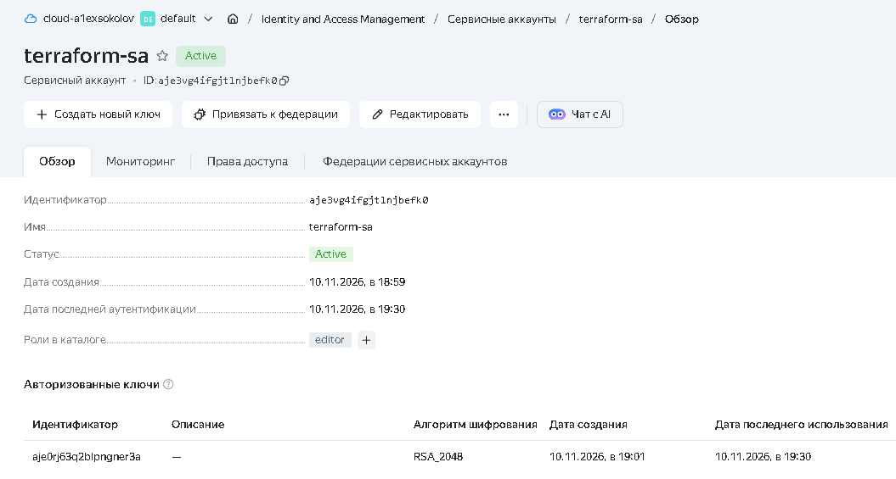
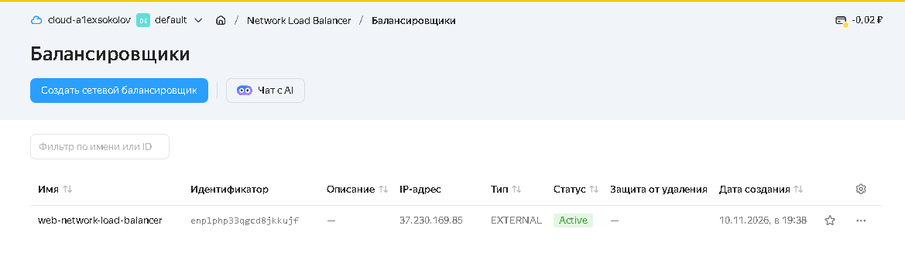
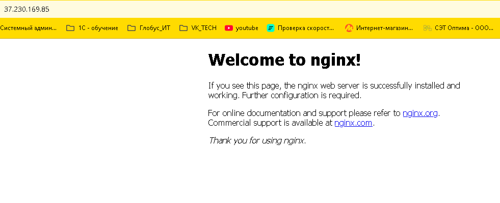

# Домашнее задание к занятию "`Отказоустойчивость в облаке`" - `Соколов Алексей`


### Инструкция по выполнению домашнего задания

   1. Сделайте `fork` данного репозитория к себе в Github и переименуйте его по названию или номеру занятия, например, https://github.com/имя-вашего-репозитория/git-hw или  https://github.com/имя-вашего-репозитория/7-1-ansible-hw).
   2. Выполните клонирование данного репозитория к себе на ПК с помощью команды `git clone`.
   3. Выполните домашнее задание и заполните у себя локально этот файл README.md:
      - впишите вверху название занятия и вашу фамилию и имя
      - в каждом задании добавьте решение в требуемом виде (текст/код/скриншоты/ссылка)
      - для корректного добавления скриншотов воспользуйтесь [инструкцией "Как вставить скриншот в шаблон с решением](https://github.com/netology-code/sys-pattern-homework/blob/main/screen-instruction.md)
      - при оформлении используйте возможности языка разметки md (коротко об этом можно посмотреть в [инструкции  по MarkDown](https://github.com/netology-code/sys-pattern-homework/blob/main/md-instruction.md))
   4. После завершения работы над домашним заданием сделайте коммит (`git commit -m "comment"`) и отправьте его на Github (`git push origin`);
   5. В личном кабинете прикрепите и отправьте ссылку на решение в виде md-файла в вашем Github.
   6. Любые вопросы по выполнению заданий спрашивайте в разделе “Вопросы по заданию” в личном кабинете.
   
Желаем успехов в выполнении домашнего задания!
   
### Дополнительные материалы, которые могут быть полезны для выполнения задания

1. [Руководство по оформлению Markdown файлов](https://gist.github.com/Jekins/2bf2d0638163f1294637#Code)

---

# Домашнее задание "Отказоустойчивость в облаке"
Выполнил: Соколов Алексей

## 1. Terraform Playbook

### providers.tf
```hcl
terraform {
  required_providers {
    yandex = {
      source = "yandex-cloud/yandex"
    }
  }
}

provider "yandex" {
  service_account_key_file = "key.json"
  folder_id                = var.folder_id
  zone                     = var.zone
}
```

### variables.tf
```hcl
variable "folder_id" {
  description = "ID каталога в Yandex Cloud"
  type        = string
  default     = "b1gsvg30664fm4410610"
}

variable "zone" {
  description = "Зона доступности"
  type        = string
  default     = "ru-central1-a"
}
```

### network.tf
```hcl
resource "yandex_vpc_network" "network" {
  name = "hw-network"
}

resource "yandex_vpc_subnet" "subnet" {
  name           = "hw-subnet"
  zone           = var.zone
  network_id     = yandex_vpc_network.network.id
  v4_cidr_blocks = ["10.0.1.0/24"]
}
```

### instances.tf
```hcl
resource "yandex_compute_instance" "web" {
  count       = 2
  name        = "web-vm-${count.index + 1}"
  platform_id = "standard-v1"

  resources {
    cores         = 2
    memory        = 1
    core_fraction = 20
  }

  scheduling_policy {
    preemptible = true
  }

  boot_disk {
    initialize_params {
      image_id = "fd8li2lvvfc6bdj4c787"
      size     = 10
    }
  }

  network_interface {
    subnet_id = yandex_vpc_subnet.subnet.id
    nat       = true
  }

  metadata = {
    ssh-keys = "ubuntu:${file("C:/Users/admin/.ssh/id_ed25519.pub")}"
    
    user-data = <<-EOF
      #cloud-config
      package_update: true
      packages:
        - nginx
      runcmd:
        - [ systemctl, enable, nginx ]
        - [ systemctl, start, nginx ]
    EOF
  }
}
```

### balancer.tf
```hcl
resource "yandex_lb_target_group" "web-group" {
  name = "web-target-group"

  dynamic "target" {
    for_each = yandex_compute_instance.web[*].network_interface[0].ip_address
    content {
      subnet_id = yandex_vpc_subnet.subnet.id
      address   = target.value
    }
  }
}

resource "yandex_lb_network_load_balancer" "web-lb" {
  name = "web-network-load-balancer"

  listener {
    name = "http-listener"
    port = 80
    external_address_spec {
      ip_version = "ipv4"
    }
  }

  attached_target_group {
    target_group_id = yandex_lb_target_group.web-group.id

    healthcheck {
      name = "http-healthcheck"
      http_options {
        port = 80
        path = "/"
      }
    }
  }
}
```

### outputs.tf
```hcl
output "lb_external_ip" {
  description = "Внешний IP-адрес балансировщика"
  value       = tolist(tolist(yandex_lb_network_load_balancer.web-lb.listener)[0].external_address_spec)[0].address
}
```

## 2. Созданные виртуальные машины



## 3. Статус балансировщика и целевой группы



## 4. Ответ Nginx

